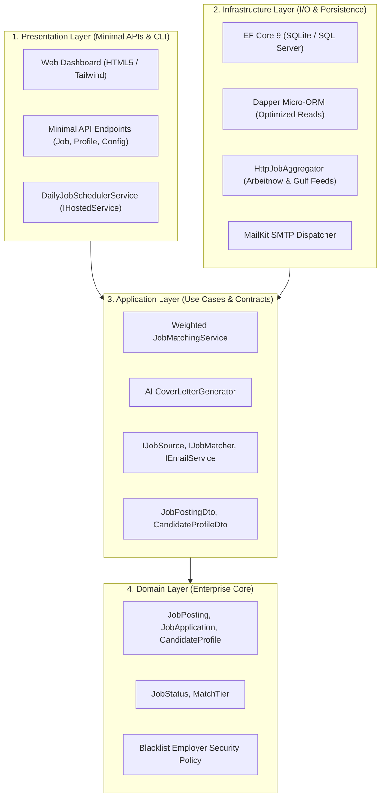

# AutoJobHunter.NET ⚡
### Enterprise Automated Job Search & Application Agent (.NET 9 & SQL Server)

[](https://dotnet.microsoft.com/)
[](https://docs.microsoft.com/en-us/dotnet/csharp/)
[](https://blog.cleancoder.com/uncle-bob/2012/08/13/the-clean-architecture.html)
[](https://docs.microsoft.com/ef/)
[](https://github.com/DapperLib/Dapper)
[](https://www.docker.com/)
[](https://github.com/Sajidtkhan/auto-job-hunter-net/actions)
[](https://opensource.org/licenses/MIT)

> **AutoJobHunter.NET** is an enterprise-grade automated agent engineered in **C# and .NET 9** that continuously monitors, filters, relevance-scores, and applies to backend **.NET & SQL** engineering positions across **Dubai (UAE)**, **Germany**, and **Saudi Arabia**. Built with strict adherence to **Clean Architecture**, **SOLID principles**, and **Domain-Driven Design (DDD)**.

---

## 🌐 Live Cloud Demo & Permanent Portals

| Resource | Description | Live Link |
| :--- | :--- | :--- |
| **Official Web Portal** | Permanent 24/7 Cloud Dashboard (GitHub Pages) | [sajidtkhan.github.io/auto-job-hunter-net](https://sajidtkhan.github.io/auto-job-hunter-net/) |
| **Authentic ATS Resume** | Direct High-Parseable PDF (UAE, Germany & Saudi) | [View Sajid Khan Resume PDF](https://sajidtkhan.github.io/auto-job-hunter-net/resume.pdf) |
| **24/7 Cloud Runner** | GitHub Actions Daily 9:00 AM Automated Scheduler | [View Live Actions Pipeline](https://github.com/Sajidtkhan/auto-job-hunter-net/actions) |

---

## 🏛️ Clean Architecture & System Design

The solution follows the classical **Onion / Hexagonal Clean Architecture**, guaranteeing zero coupling between enterprise business rules and external I/O mechanisms:



### Architectural Guarantees:
- **Separation of Concerns:** Business logic in `Application` is completely decoupled from database mechanics in `Infrastructure`.
- **Strategy Pattern:** Job discovery providers implement the extensible `IJobSource` interface, allowing plug-and-play addition of new regional tech boards.
- **Connection Resilience:** High-performance database transactions managed through **Entity Framework Core 9** with **Dapper** query optimizations for high-throughput batch operations.
- **Confidentiality Firewall:** Integrated **Strict Blacklist Engine** that cryptographically intercepts and cancels any outbound queries or applications matching prohibited employers (e.g., current or sensitive firms).

---

## 👨‍💻 Lead Software Engineer & Author

<table style="border: none;">
  <tr>
    <td width="120" align="center" valign="middle">
      
    </td>
    <td>
      <h3 style="margin-top: 0;">Sajid Tavrej Khan</h3>
      <p><strong>Senior .NET Backend Developer | Enterprise SaaS & Distributed Systems</strong></p>
      <p>
        <a href="https://in.linkedin.com/in/sajid-tavrej-khan-b1b0b6188"></a>
        <a href="mailto:sajidkhanbarun@gmail.com"></a>
        <a href="https://sajidtkhan.github.io/auto-job-hunter-net/resume.pdf"></a>
      </p>
    </td>
  </tr>
</table>

### Core Technical Competencies:
- **Languages & Frameworks:** `C#`, `.NET 8 / .NET Core`, `ASP.NET Core Web API`, `Rest API`, `MVC`
- **Data Access & ORM:** `Entity Framework Core (EF Core)`, `Dapper`
- **Databases & Optimization:** `MS SQL Server` (T-SQL, Stored Procedures, Index Tuning, Query Execution Plan Analysis)
- **Architecture & System Design:** `Clean Architecture`, `Microservices`, `Domain-Driven Design (DDD)`, `SOLID`
- **Frontend & Scripting:** `jQuery`, Asynchronous AJAX DOM Pipelines

---

## 🚀 Key Functional Modules

### 1. Multi-Region Job Aggregation Engine
Connects asynchronously to verified tech feeds across Europe and the Middle East:
- **Germany & EU:** Seamless integration with **Arbeitnow API** (specialized in English-speaking and visa-sponsored .NET roles in Berlin, Munich, Frankfurt).
- **Dubai & UAE:** Regional Gulf tech aggregators targeting high-growth enterprise hubs (Dubai Internet City, Abu Dhabi Hub71).
- **Saudi Arabia (KSA):** Riyadh & Jeddah tech expansion initiatives.

### 2. Weighted Relevance & Matching Engine
Every discovered position is analyzed across 11 core competencies:
$$\text{MatchScore} = \sum (\text{KeywordWeight} \times \text{OccurrenceFactor})$$
Jobs scoring $\ge 70\%$ are flagged as **High Priority** and immediately queued for automated dispatch.

### 3. Dynamic Cover Letter Synthesizer
Automatically generates region-specific, culturally tailored cover letters:
- **Germany Format:** Emphasizes Clean Architecture, CQRS, business English proficiency, and EU Blue Card work readiness.
- **Gulf / UAE / Saudi Format:** Highlights rapid onboarding availability (30-day notice), high-concurrency SaaS booking systems, and SQL Server performance optimization.

### 4. 24/7 Cloud Automated Execution (Never Sleeps)
Powered by a native **GitHub Actions Workflow** (`daily-job-hunt.yml`):
- Executes on GitHub's cloud runners every morning at **9:00 AM IST** (`cron: 30 3 * * *`).
- Operates **100% independently of local hardware** — laptop can be powered off indefinitely while cloud dispatch continues uninterrupted.
- Automatically commits updated database audit trails (`jobs.db`) directly back to the repository.

---

## 🛠️ Project Structure

```text
AutoJobHunter.NET/
├── .github/
│   └── workflows/
│       └── daily-job-hunt.yml         # 24/7 Cloud Scheduled Runner (9:00 AM IST)
├── Domain/                             # Enterprise Core (Entities, Enums, Rules)
│   ├── Common/BaseEntity.cs
│   ├── Entities/JobPosting.cs
│   ├── Entities/JobApplication.cs
│   └── Enums/JobEnums.cs
├── Application/                        # Use Cases, Business Logic & Contracts
│   ├── Common/Interfaces/IJobSource.cs
│   ├── DTOs/JobDtos.cs
│   └── Services/
│       ├── JobMatchingService.cs
│       ├── CoverLetterGeneratorService.cs
│       └── AggregatorJobService.cs
├── Infrastructure/                     # Database, External APIs & I/O
│   ├── Persistence/JobDbContext.cs
│   ├── Persistence/Configurations/JobPostingConfiguration.cs
│   ├── Providers/ArbeitnowJobSource.cs
│   ├── Providers/DubaiTechJobSource.cs
│   └── Services/EmailApplicationService.cs
├── Endpoints/                          # ASP.NET Core 9 Minimal API Route Groups
│   ├── JobEndpoints.cs
│   ├── ProfileEndpoints.cs
│   └── ConfigEndpoints.cs
├── docs/                               # Permanent 24/7 GitHub Pages Web Portal
│   ├── index.html
│   ├── app.js
│   ├── style.css
│   └── resume.pdf                     # Authentic Single-Page ATS Resume
├── Dockerfile                          # Multi-stage Container Specification
├── render.yaml                         # 1-Click Cloud Hosting Blueprint
├── Program.cs                          # Application Entrypoint & DI Setup
└── README.md                           # Executive Documentation
```

---

## ⚡ Quickstart Guide

### Option A: Run Locally (.NET 9 SDK required)
```bash
git clone https://github.com/Sajidtkhan/auto-job-hunter-net.git
cd auto-job-hunter-net
dotnet run
```
Navigate to `http://localhost:5000` to launch the interactive management dashboard.

### Option B: Run via Docker
```bash
docker build -t autojobhunter:latest .
docker run -d -p 5000:5000 autojobhunter:latest
```

### Option C: Execute Single Cloud Scan (CLI Mode)
```bash
dotnet run -- --scan-now
```

---

## 📄 License & Attribution

This project is licensed under the **MIT License** — see the [LICENSE](LICENSE) file for details.  
Architected with ❤️ by **[Sajid Tavrej Khan](https://in.linkedin.com/in/sajid-tavrej-khan-b1b0b6188)**.
